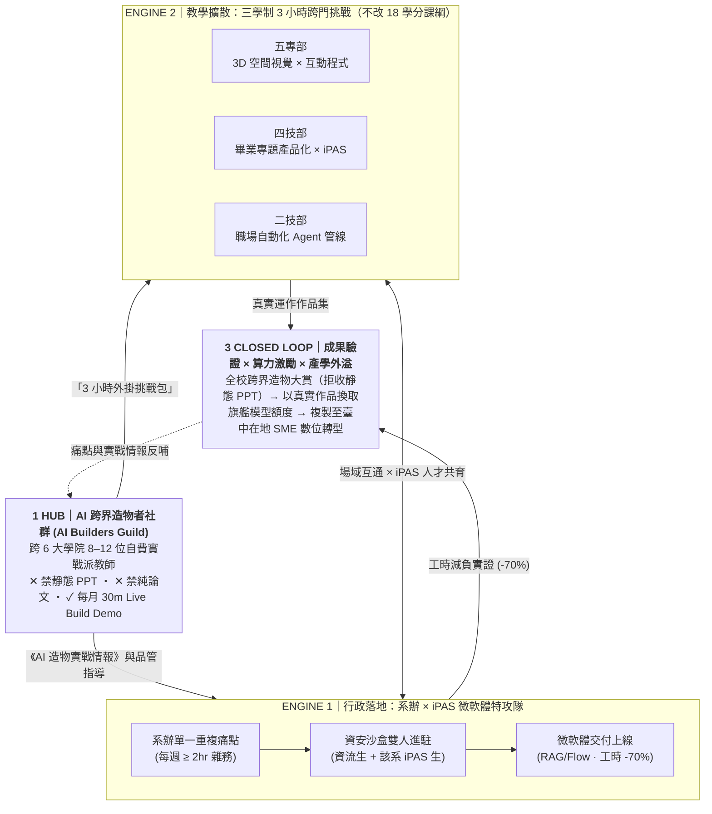
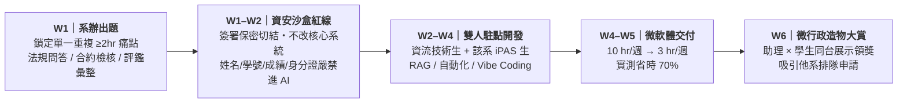
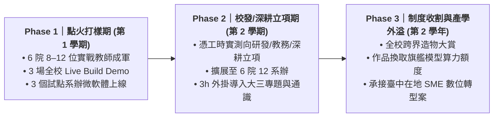

# 國立臺中科技大學「打開另一扇門：AI 跨界造物」校務發展計畫

> **線上藍圖網頁**：[https://drchunchihchen.github.io/nutc-ai-open-door/](https://drchunchihchen.github.io/nutc-ai-open-door/)
> **完整計畫書**：[./PLAN.md](./PLAN.md) ｜ **分鏡設計規範**：[./Motion.md](./Motion.md) ｜ **26 格影片分鏡總覽**：[./docs/assets/sheet_zh.png](./docs/assets/sheet_zh.png)

拒絕將 AI 矮化為「做簡報、寫公文」的文書加速器；以「做出過去做不出的真實作品」為最高準則，驅動 **15,600+ 師生、6 大學院、五專／四技／二技** 啟動跨界造物雙引擎。

---

## 1-2-3 雙引擎核心架構圖

---

## 行政端 6 週資安沙盒改造流水線

---

## 中部各校策略定位對比

| 校別 | 他校模式 | 核心特徵 | 臺中科大「跨界造物雙引擎」破局對應 |
| :--- | :--- | :--- | :--- |
| **東海大學** | 重算力基地 | 高資本硬體中心與長期採購 | 不打硬體軍備戰，採國內代理商統編授權租賃雲端前沿池 |
| **暨南大學** | Astra 平台額度 | 統一平台帳號全面配發 | 廢除無門檻大放送，改「以真實作品換旗艦算力額度」 |
| **雲林科技大學** | AI4BI 18 學分 | 完整 18 學分跨院微學程 | 不擠壓滿載學分，拆解為「3 小時 Plug-and-Play 跨門外掛」 |
| **逢甲大學** | 行政 AI 競賽 | 短期創意競賽導向 | 「系辦 × iPAS」雙人 6 週駐點寫成可維運微軟體，實測省時 70% |
| **國立臺中科技大學** | **跨界造物雙引擎** | **1 樞紐 × 行政微軟體 × 三學制 3h 外掛** | **拒收靜態 PPT；交付可運行軟體、3D 空間視覺與程式影音** |

---

## 三階段滾動路線與合規防坑

* **主計室合規核銷**：避開個人境外刷卡，透過國內代理商開立學校統編發票核銷雲端 API／教育團隊授權；並編列外掛教材開發費、講座鐘點費、兼任工讀金與 iPAS 考照獎補助。
* **資安與資料治理紅線**：簽署保密切結，所有 AI 工具僅處理公開法規、去識別化流程與空白表單檢核。
* **成果驗證標準**：任何受補助團隊必須附上可運行軟體連結、程式碼倉儲、3D 模型或動態影音成品。

---

## 目錄與檔案結構

* `docs/` — GitHub Pages 靜態藍圖網站（`index.html`、`styles.css`、`app.js`、`.nojekyll`、`assets/`）
* `videos/nutc_open_door/` — HTML + GSAP + Canvas 程式化動態影片專案
* `scripts/` — 音訊合成與 `earshot` 混音管線腳本
* [PLAN.md](./PLAN.md) — 完整校務發展計畫書
* [Motion.md](./Motion.md) — 7 幕影片視覺與動態分鏡規格
